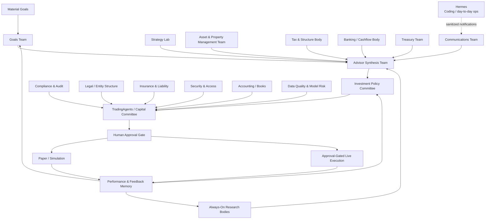

# Wealth Agents Private Office Design

Date: 2026-05-03
Status: Draft for review

## Summary

Wealth Agents is the private-office system of record for Michael's personal management company. It is not primarily a trading dashboard. Webull remains the high-touch trading cockpit, while Wealth Agents manages goals, reports, policies, approvals, paperwork, property records, tax notes, advisor guidance, and agent-generated research.

The product should feel like an agent-run investment office, trust-management office, and personal asset office. Agent teams gather information, produce reports, maintain records, communicate through structured interfaces, and escalate decisions. They do not get direct authority over money, broker credentials, banking credentials, legal structures, or personal communications without explicit policy and approval gates.

Hermes may live on the same always-on MacBook server, but it has a different job. Hermes is Michael's day-to-day operations and coding-project agent. It can help monitor practical household/project concerns and may act as a communications router, but it is not the financial system of record and should not have privileged connectivity into Wealth Agents, brokers, banks, or the document vault.

## Product Boundary

### Wealth Agents

Wealth Agents owns:

- material goals and progress tracking
- daily, weekly, monthly, and quarterly advisor briefings
- deep research reports and decision ledgers
- agent team configuration and scheduled research bodies
- capital committee records and approval workflows
- tax, accounting, legal, insurance, property, and document records
- communications intake, triage, and journal capture
- A2UI-rendered agent workspaces
- A2A agent-to-agent task coordination
- backup, recovery, and auditability

### Hermes

Hermes owns:

- coding-project management
- local development and operational automations
- hands-on day-to-day monitoring tasks where useful
- messaging convenience across configured channels
- possible communications routing into Wealth Agents after sanitization

Hermes must not own:

- broker keys
- banking credentials
- Wealth Agents document vault credentials
- final financial records
- approval authority
- tax/legal/accounting source-of-truth records
- direct write access to Wealth Agents' core database

Hermes can receive outbound notification tasks from Wealth Agents and can forward inbound messages to the Communications Team, but the boundary must be explicit and logged.

## Deployment Shape

The first deployment target is a dedicated MacBook running as a local server.

Core services:

- Wealth Agents web app
- Wealth Agents backend/API
- local database
- document vault storage
- scheduled job runner
- A2A message bus
- A2UI renderer and component registry
- optional Hermes installation in a separate runtime/home directory

Access surfaces:

- local/private web app
- macOS app
- iOS app

No other client is required for v1. External messaging channels can be added through the Communications Team or Hermes routing, but the canonical interfaces are web, macOS, and iOS.

## Backup And Recovery

Because this system becomes the private-office record, backup is a first-class requirement.

V1 backup requirements:

- encrypted local daily snapshots
- encrypted off-machine backup target
- database backup plus document vault backup
- configuration export without exposing raw secrets
- restore test checklist
- backup health shown in Settings
- warnings when backups fail or become stale

Recommended backup targets:

- local external drive for fast restore
- encrypted cloud backup for disaster recovery
- periodic archive export for tax/legal/accounting review

Secrets should be backed up only through the operating system keychain or an explicit encrypted secret export. Plaintext `.env` files, broker keys, bank keys, and email credentials must not be included in ordinary document exports.

## Agent Communication Model

Agents communicate internally through A2A and communicate with Michael through A2UI surfaces, inbox messages, notifications, and approved external channels.

### A2A

A2A is the internal coordination layer between agent teams. It should carry:

- task requests
- source requests
- report artifacts
- confidence notes
- conflicts and objections
- escalation requests
- approval requests
- post-action outcomes

A2A messages should be stored or summarized so important decisions can be reconstructed later.

### A2UI

A2UI is the preferred user-facing communication format for agents. Agents are encouraged to render structured interfaces rather than plain walls of text.

Approved A2UI surfaces include:

- morning brief
- report dossier
- evidence board
- decision DAG
- goal-progress view
- asset/liability dossier
- approval card
- tax issue card
- document checklist
- advisor memo
- incident/claim log
- backup health panel

A2UI payloads must use a constrained component registry. Agents can compose approved components and bind structured data, but cannot ship arbitrary executable UI.

## Communications Team

The Communications Team is the gate between agent activity and Michael's attention.

Responsibilities:

- collect messages from agent teams
- rank urgency and importance
- suppress noise
- decide whether to send a notification, email, iMessage-style message, or only an internal inbox item
- mirror important external communications into the decision journal
- route inbound messages to the right team
- maintain agent/team email identities where useful

Agent identities can exist, but micro-agents should not freely message Michael. Team-level identities are preferred:

- advisor@
- capital@
- goals@
- treasury@
- tax@
- legal@
- property@
- documents@
- risk@
- smartmoney@

Hermes may help deliver or collect messages, but Wealth Agents remains the canonical communication record.

## Operating Hierarchy

## Agent Bodies

### Goals Team

Tracks material goals and whether current strategy is moving Michael closer to them.

Examples:

- yacht acquisition
- property acquisition
- business capital
- liquidity targets
- retirement or independence targets
- major purchases
- lifestyle or family-office goals

Outputs:

- goal dossier
- feasibility report
- capital path
- liability summary
- tax/legal/advisor dependency list
- progress update

### Advisor Synthesis Team

Creates the morning and periodic executive brief. It reads other team outputs, suppresses noise, and explains what matters.

Outputs:

- morning synopsis
- weekly portfolio and goal report
- monthly management report
- urgent escalation summary

### Always-On Research Bodies

Scheduled research teams that watch markets and gather intelligence.

Bodies:

- Market Watch
- Smart Money
- Company Intelligence
- Macro / Fed / Rates
- Earnings and Events
- News and Sentiment
- Options Flow
- Insider / Congress / Lobbying / Contracts

Outputs:

- alerts
- source packs
- deep research triggers
- watchlist updates
- event markers

### TradingAgents / Capital Committee

The CFO-style capital stewardship team. It decides whether an opportunity deserves capital and under what constraints.

Roles:

- Chief Capital Officer
- Portfolio CFO
- P&L Controller
- Risk CFO
- Tax CFO
- Execution CFO
- Performance Auditor

Key questions:

- How much capital can we responsibly commit?
- What is expected upside and downside?
- What is max loss?
- What happens if the thesis is wrong?
- What goal does this advance?
- Is this better than cash, treasuries, SPY, QQQ, debt paydown, or waiting?
- What tax consequence does this create?
- Should this be simulated first?

### Strategy Lab

Tests before capital is committed.

Paper trade types:

- historical backtest
- forward paper simulation
- broker sandbox execution
- shadow trade against actual behavior
- counterfactual trade
- strategy tournament
- risk drill

### Tax & Structure Body

Reviews tax implications and structure ideas. It produces CPA-reviewable memos, not final professional advice.

Scope:

- realized/unrealized gains
- holding periods
- wash-sale risk
- option assignment issues
- dividend and interest tax treatment
- loss harvesting candidates
- entity and trust considerations
- major purchase ownership structures

### Asset & Property Management Team

Manages non-portfolio assets and related paperwork.

Assets:

- houses
- cars
- boats
- firearms
- equipment
- trailers
- storage units
- collectibles
- other titled or insured assets

Agents:

- Asset Registry Agent
- Document Custodian Agent
- Liability Monitor Agent
- Maintenance Scheduler Agent
- Insurance Coverage Agent
- Entity / Ownership Liaison
- Valuation Agent
- Incident / Claims Agent
- Access & Custody Agent
- Compliance Calendar Agent

For firearms, Wealth Agents stays in the compliance/documentation lane: inventory, serials, secure storage records, insurance, ownership documents, transfer records, maintenance logs, and jurisdiction-specific reminders. It must not provide operational or tactical guidance.

### Governance And Control Teams

Additional corporate-style control bodies:

- Investment Policy Committee
- Treasury Team
- Compliance & Audit Team
- Legal / Entity Structure Team
- Insurance & Liability Team
- Estate & Succession Team
- Counterparty / Vendor Risk Team
- Security & Access Team
- Accounting / Books Team
- Data Quality Team
- Model Risk Team
- Scenario & Stress Team
- Opportunity Cost Team
- Behavioral Coach Team
- Document Vault Team
- Privacy / Compartmentalization Team
- Board Minutes / Decision Journal

## Data And Records

Core entities:

- Goal
- GoalMilestone
- AgentTeam
- AgentRun
- A2AMessage
- A2UIArtifact
- Report
- EvidenceItem
- SourceRecord
- Decision
- Approval
- PolicyRule
- InvestmentPolicy
- Asset
- AssetDocument
- Liability
- InsurancePolicy
- MaintenanceEvent
- AdvisorContact
- AdvisorGuidance
- TaxIssue
- AccountingEntry
- Communication
- Notification
- BackupSnapshot

Every important artifact should carry:

- source
- timestamp
- confidence
- owner team
- related goal or asset
- related decision, if any
- whether it is informational, advisory, simulated, approval-gated, or executed

## Privacy And Permissions

Agents get least-privilege access.

Examples:

- Market Watch can read market data and watchlists, not banking.
- Goals Team can read goal and portfolio summaries, not raw broker credentials.
- Tax Body can read tax records and trade history, but cannot place trades.
- Property Team can read asset documents, not model provider keys.
- Hermes can send or receive sanitized communications, not read the Wealth Agents vault directly.
- Execution agents can create proposals, but live execution requires human approval and broker-specific guards.

Permissions should be role-based and auditable.

## App Surfaces

Required first-party clients:

- web app
- macOS app
- iOS app

Shared concepts across clients:

- morning brief
- internal inbox
- goal dossiers
- deep research reports
- asset registry
- document vault
- approval center
- communications journal
- backup/settings

The web app can ship first. The macOS and iOS apps should consume the same backend APIs and render the same A2UI artifacts where practical.

## Non-Goals

- Do not replace Webull as the primary hands-on trading cockpit.
- Do not make Hermes the financial system of record.
- Do not give Hermes broker, banking, or document-vault authority.
- Do not build Android or Windows apps in v1.
- Do not enable autonomous live trading.
- Do not treat agent output as legal, tax, accounting, insurance, or investment advice without human professional review.

## Open Implementation Questions

- Which database should be used first on the MacBook server: SQLite for simplicity or Postgres for durability and concurrency?
- Which encrypted backup target should be the first off-machine destination?
- Should document vault encryption use macOS Keychain, age/sops-style file encryption, or a dedicated vault service?
- Should Hermes communicate with Wealth Agents through webhooks, a local queue, email, or a constrained A2A adapter?
- Which iOS/macOS framework should be used for native clients: SwiftUI native clients or a shared web wrapper first?
- How should A2UI artifacts be versioned so old reports remain renderable after component changes?

